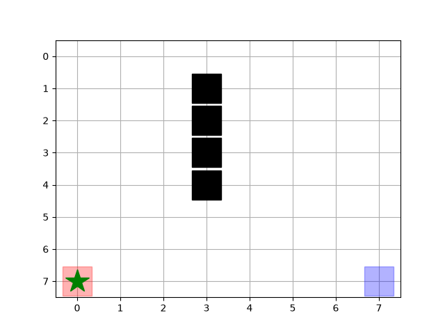
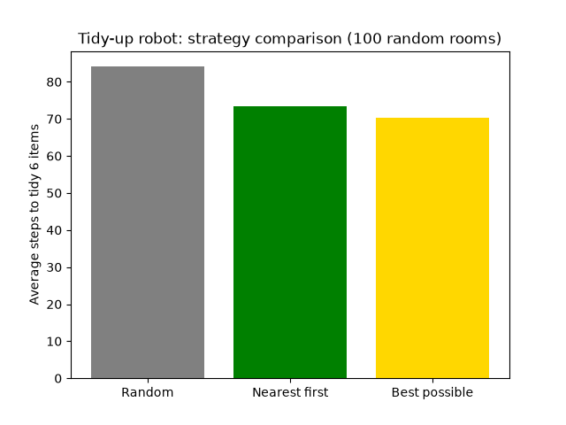

# Tidy-Up Robot Simulation

A simulated household robot in a 2D grid room. It finds items on the floor,
picks each one up, and delivers it to the bin matching its color, planning
routes around furniture using Breadth First Search (BFS).

## What it does
- 8x8 room with furniture the robot cannot pass through
- BFS finds the shortest route between any two cells
- Robot routine: go to item, pick up, deliver to the matching bin, repeat
- matplotlib animates the robot

## Strategy comparison
I compared three ways of choosing the order of items, averaged over
100 random rooms with 6 items each:

| Strategy | Average steps |
|---|---|
| Random order | XX |
| Nearest item first | XX |
| Best possible (brute force) | XX |

Nearest-first used about XX% fewer steps than random order.

Nearest-first is a greedy strategy: simple and fast. Brute force checks
every order, so it is optimal but only practical for a few items.

## Run it
pip install matplotlib numpy
python tidy_robot.py   (animation)
python compare.py      (strategy comparison)

## Next steps
- Replace BFS with A*
- Move to a 3D simulation (PyBullet)
- Add a camera and object detection
- Run on a real robot (ESP32)
